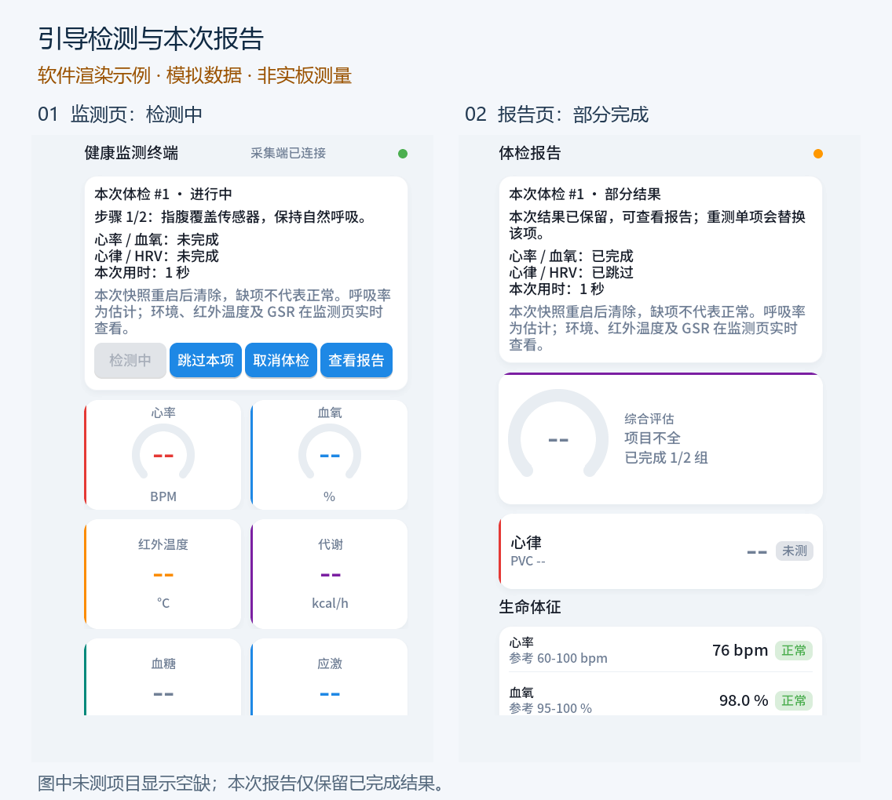

# PSoC Edge Health Monitor

[中文](README.md) · [Build prerequisites](BUILDING.md) · [Licensing](THIRD_PARTY_NOTICES.md)

A dual-core health-monitoring research prototype for PSoC Edge E84. Cortex-M33 manages sensor acquisition; Cortex-M55 handles ECG analysis, LVGL interaction and networking. Both cores run RT-Thread.

Features include guided PPG/ECG checkups, signal/contact guidance, retry/skip/cancel controls, per-session frozen reports, HRV and respiratory-rate estimation, infrared/environmental sensing, GSR, Wi-Fi configuration, asynchronous voice-report logic, a Flask dashboard, per-device trends and CSV export.



This repository is a **source overlay**, not a standalone vendor SDK distribution. Restore the BSP, libraries and generated assets described in [BUILDING.md](BUILDING.md) before compiling firmware. Trained models, real ECG fixtures and audio assets are excluded; their code and generation paths are documented. Original code is MIT-licensed; third-party components retain their own terms.

Quick portable test (Python 3.11+):

```sh
python -m pip install -r dashboard/requirements.txt
python -m unittest discover -s dashboard/tests -v
```

A [GitHub Actions template](docs/ci/github-actions-checks.yml) is included but not enabled: the publishing credential cannot write workflows. A maintainer with workflow write access can copy it to `.github/workflows/checks.yml`. It runs dashboard tests only, not MCU builds.

The original development environment passed offline tests and paired firmware builds. This public snapshot has different network defaults and excluded assets; it has not been validated on hardware. Screenshots use simulated data. Glucose, blood-pressure, BMR and blood-flow research paths are not validated measurement features. This is not a medical diagnostic device.

Network configuration is deliberately empty/local. The example dashboard lacks production authentication and the MQTT example lacks TLS configuration. Use an isolated development network with synthetic data until deployment protections are implemented.
