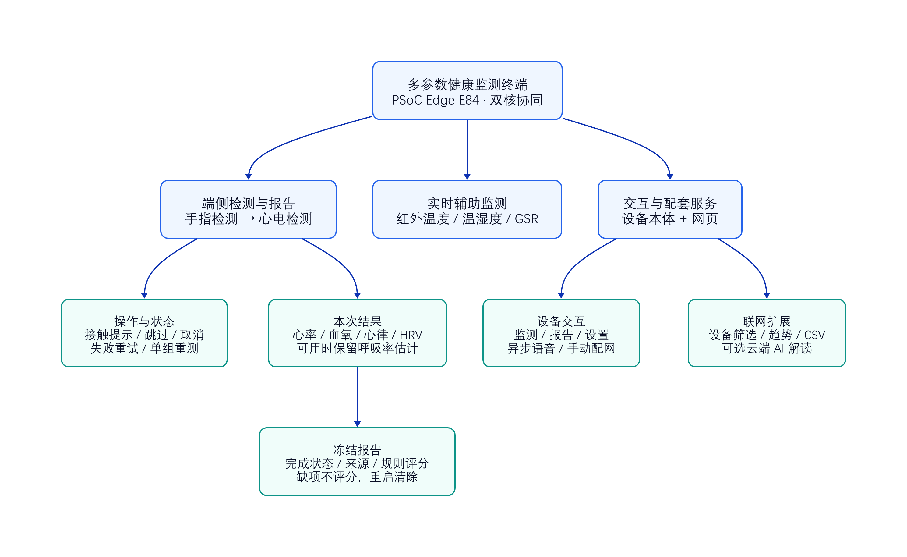
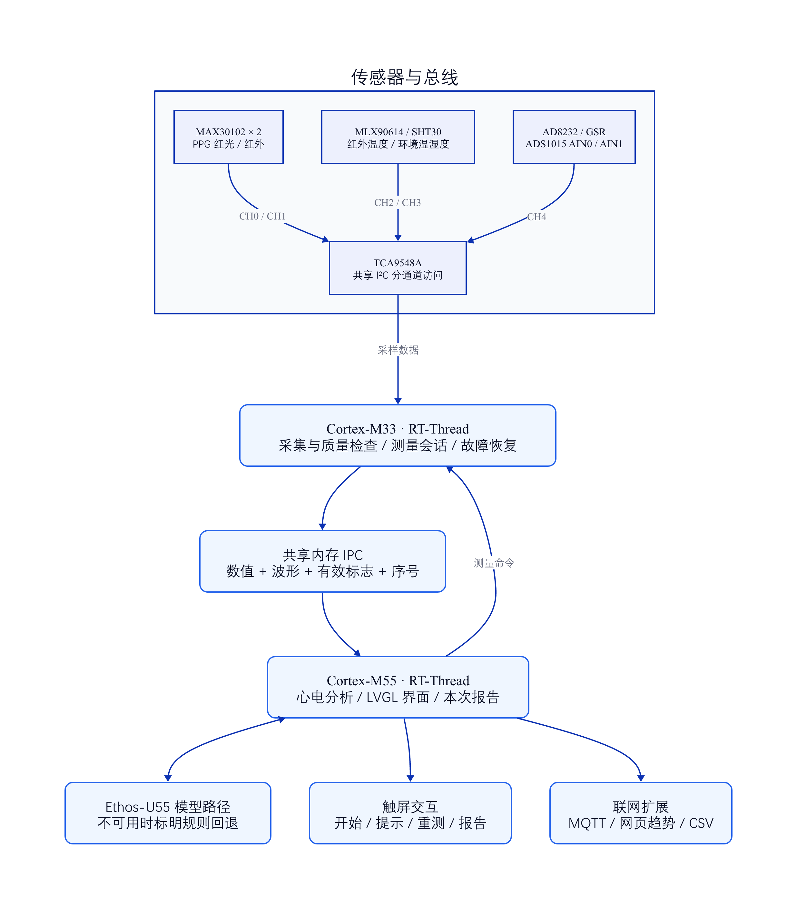
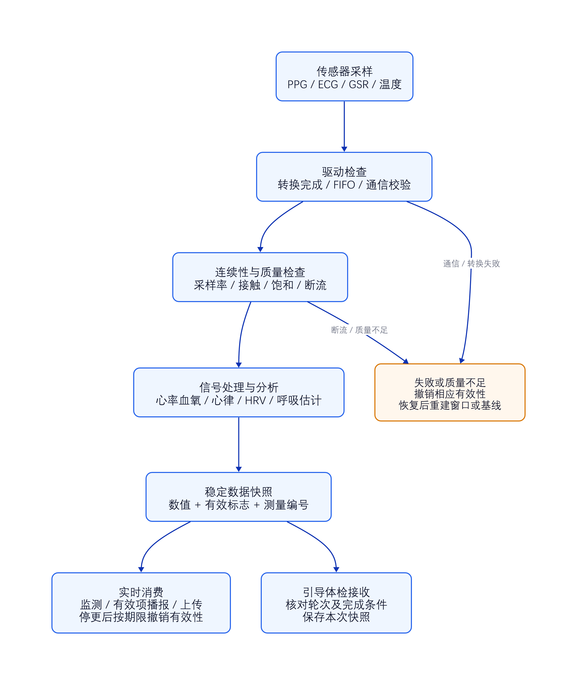
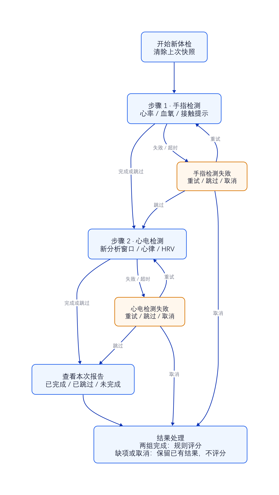

# 基于PSoC Edge E84的双核多参数健康监测终端

健康监测终端既要采到信号，也要回答一个更实际的问题：屏幕上的结果来自哪次测量，当前是否有效，测量失败时用户该怎么做？围绕这些问题，我们基于英飞凌 PSoC Edge E84 平台，设计了一个面向家庭健康观察场景的多参数监测原型。

作品将传感器采集、信号处理、端侧心律分析和触屏交互组织为完整流程。用户可以从屏幕发起一次检测，依次完成手指与心电两个项目组，在结束后查看本次报告。开发重点包括双核协同、信号质量控制，以及设备断连、接触不良和数据过期时的处理。

从使用体验看，作品包含设备本体和配套网页两部分。设备本体承担核心检测与本地交互，即使没有云端建议服务，也能运行测量流程；网络可用并配置好服务后，数据可以进入网页，按设备查看历史趋势、导出对照记录，并选择使用云端文本解读。两部分围绕同一套有效性规则组织，避免设备端显示“未测”，网页端却继续把旧值作为新结果。

本文从功能、硬件、算法、界面、联网和工程交付六个方面介绍作品。为方便理解，文中的“体检”指本项目的引导式多参数检测流程，不代表医院体检或临床诊断；软件功能、离线测试结果与尚待完成的实板验证会分别说明。

## 一、作品定位：从实时数据显示到一次完整检测

终端围绕两组核心项目组织引导流程：手指检测提供心率与血氧估算，心电检测提供心律分析和心率变异性（HRV）指标。同时，监测页保留红外温度、环境温湿度和皮肤电反应（GSR）等实时信息。

| 功能 | 用户可以看到什么 | 当前使用边界 |
| --- | --- | --- |
| 手指检测 | 心率、血氧及接触提示 | 通过信号质量检查后才接受结果，实际精度待参考对照 |
| 心电分析 | 心律类别、室早相关计数、HRV | 标明模型或规则分析来源，依赖连续有效窗口 |
| 呼吸率估算 | 有效时随心电结果保留 | 属于基于心搏间期变化的估计值 |
| 辅助监测 | 红外温度、环境温湿度、GSR 相对指标 | 红外温度不等同于核心体温；GSR 不作为心理诊断 |
| 本次报告 | 项目完成状态、结果及规则评分 | 缺项不提供总评分，快照重启后清除 |

本作品当前属于工程原型。血糖、血压、基础代谢率和血流速度相关研究接口不作为本版已经验证的检测能力；其中缺少可靠输入或标定依据的结果保持无效，不用固定“正常值”填补。

### 1. 围绕三类实际需求组织功能

第一类是“完成一次检测”。用户不需要理解采样窗口或双核通信，只需发起体检、根据提示放好手指和连接电极。系统负责等待信号、确认结果、推进下一阶段，并将失败项目与已完成项目区分开。

第二类是“了解设备为什么没有结果”。监测页提供操作提示，设置页提供采集端、各类数据和网络连接状态。例如，心率尚未完成、心电窗口不足、Wi-Fi 未连接与上传服务未连接，对用户的处理方式不同，不能都归结为“设备故障”。

第三类是“回看与验证数据”。本机提供冻结的本次报告，网页提供上传历史及 CSV 导出，固件包保留构建日志和版本输入。开发者可以据此组织对照实验，检查某次结果的来源及软件版本。

*图1：作品功能全景。端侧引导报告、实时辅助监测与网页遥测历史各有用途，长期保存本次报告仍是后续扩展项。*

### 2. 完整功能清单

| 功能层 | 当前代码提供的功能 | 用户或开发者获得的价值 |
| --- | --- | --- |
| 检测入口 | 一键开始、两阶段推进、实时提示 | 把分散的采集结果组织成操作流程 |
| 手指采集 | 双 PPG 接入、质量选择、稳定等待、多窗口聚合 | 在信号满足要求时形成心率与血氧结果 |
| 心电分析 | 连续采样、速率适配、心拍分析、计数窗口 | 为心律、HRV 和呼吸率估计提供数据 |
| 辅助监测 | 红外温度、环境温湿度、GSR 相对变化 | 提供检测场景和其他传感信息 |
| 操作控制 | 超时、取消、跳过、失败重试、结束后单组重测 | 设备缺失或接触不佳时仍能完成可用部分 |
| 本次报告 | 项目状态、冻结数值、来源标识、规则评分 | 明确本次完成了什么、缺少什么 |
| 语音反馈 | 新的有效手指结果触发异步播报 | 减少持续盯屏的需要，跳过无效指标 |
| 配网与状态 | 热点扫描、手动连接、连接状态及数据状态 | 在设备端完成联网和基础排障 |
| 网页配套 | 设备选择、历史趋势、有效记录占比、CSV 导出 | 支持远程查看和测量对照整理 |
| 建议服务 | 本地规则文本、可选云端 AI 解读 | 将有效数据转为易读说明，区分实时与本次数据 |
| 工程交付 | 离线回归、双核完整构建、配套清单、哈希校验 | 保留可核对的固件与验证证据 |

## 二、总体架构：采集与计算显示分工

PSoC Edge E84 的 Cortex-M33 与 Cortex-M55 分别承担采集和计算显示任务，两核运行独立的 RT-Thread 实例，通过共享内存交换数据与命令。

M33 管理传感器访问、采样连续性、测量会话及基础信号处理。M55 负责心电数据消费、端侧分析、LVGL 界面和联网扩展。这样可以把任务职责分开，但双核分工本身并不能保证采样时序正确，仍需处理共享总线等待、数据积压和缓存一致性。

*图2：按当前软件连接关系绘制的系统逻辑架构。图示说明模块分工，不代表整机已完成实板验收。*

传感器侧使用 TCA9548A 分通道访问设备。两颗 MAX30102 分别连接独立通道，解决相同 I²C 地址冲突；MLX90614 和 SHT30 分别承担红外温度与环境采集。当前代码中的心电与 GSR 信号经 ADS1015 接入：AD8232 输出连接 AIN0，GSR 输出连接 AIN1，两路共享转换器和总线访问锁。

共享数据不仅包含数值，也包含有效标志、更新序号、测量编号和必要的波形信息。M55 读取稳定快照，并按本核观察到的更新间隔判断数据是否过期，避免直接比较起点不同的双核时钟。

平台提供 Ethos-U55 NPU。工程接入了 TFLite Micro/Vela 心律模型推理路径，并保留模型不可用时的规则回退。规则回退只利用有限的心搏间期信息，不能等同于模型形态学分类，因此界面明确标注分析来源。当前文章不以尚未实测的推理延迟、功耗或分类准确率作为性能结论。

### 1. 模块化传感器连接

硬件组织采用传感模块与总线扩展组合的方式，便于分模块调试。连接设计中的关键问题有两个：两颗 MAX30102 地址相同，需要通道隔离；心电与 GSR 共用 ADS1015，不同任务必须协调通道切换和转换完成时刻。

| 模块 | 当前软件连接 | 主要用途 | 设计关注点 |
| --- | --- | --- | --- |
| MAX30102 主路 | TCA9548A CH0 | 红光、红外 PPG | FIFO 连续性、接触与信号质量 |
| MAX30102 辅路 | TCA9548A CH1 | 第二路 PPG | 与主路隔离地址，换源后重新稳定 |
| MLX90614 | TCA9548A CH2 | 红外物体/体表温度 | 通信校验、读取失败及数据新鲜度 |
| SHT30 | TCA9548A CH3 | 环境温湿度 | 转换等待释放总线、读回校验 |
| ADS1015 + AD8232 | TCA9548A CH4，AIN0 | 心电模拟信号采集 | 实际采样速率、通道残值与断流 |
| ADS1015 + GSR | TCA9548A CH4，AIN1 | 皮肤电反应相关电压 | 与心电互斥访问、基线学习与失效重置 |
| AHT20 | 板载传感器路径 | 板级环境参考 | 不以固定温度补偿代替外部环境测量 |

这里的双 PPG 并不意味着将两个结果简单平均。两路贴合情况和信号质量可能不同，直接平均可能把一路的坏数据引入好结果。当前策略是在可用来源中选择通过门控的信号，并在活动来源变化后重新积累测量窗口。

### 2. 用 RT-Thread 管理不同节奏的任务

PPG、心电、温湿度和语音的运行节奏不同。连续信号采集需要及时处理；温湿度转换不需要长期持有总线；音频播放持续时间较长，也不应该阻塞触摸界面。因此，工程将传感器采集、心电处理、联网、语音与界面更新分配给对应任务或定时回调。

共享总线采用统一的多路复用器句柄和互斥锁，将“选通道”和“访问下游设备”作为相关操作保护。对于需要等待转换的设备，在合适的位置释放锁，再在读回时重新选通，降低低速器件对连续采样的影响。锁能够保证访问顺序，但等待锁消耗的时间同样会影响采样，所以连续性检查必须把这部分等待计入。

M55 的界面线程负责 LVGL 对象操作。网络到来的文本先存入缓冲并标记待更新，再由界面侧刷新；语音通过独立任务执行。这种安排让较慢的网络和音频操作与触屏交互保持职责分离。

## 三、检测链路改进：先保证数据来源可靠

开发中发现，仅调整滤波参数或让显示值更平滑，不能解决所有不准确问题。采样率口径、丢样处理、整数溢出和旧结果残留，都会使最终数值失真。因此，我们从采集、计算到显示逐层检查。

*图3：从采样到显示、播报和上传的数据处理链。无效或不连续数据在对应阶段被拒绝，恢复后重建所需窗口。*

### 1. 心率计算使用连续样本时钟

PPG 采用 100 SPS、关闭 FIFO 平均的配置，并批量读取已有样本。空 FIFO 不补造数据；遇到溢出、明显积压或采集间断时，丢弃受影响窗口并重新积累。

心率算法按有效窗口的采样率与周期计算 bpm，去掉调用端重复缩放，同时修复峰值边界和平顶峰处理。对两路 PPG，优先选择通过质量检查的信号；测量过程中切换来源时重新稳定，不直接拼接两路历史结果。

例如，采样间隔的理解发生偏差时，即使峰值位置完全正确，换算出的心率也会系统性偏移。FIFO 读取一次得到多个点，这些点对应的是传感器内部连续采样时间，不能把主机的读取次数当成采样次数。为此，算法入口、传感器配置与调用端统一使用同一采样率口径。

对于顶部较宽的脉搏峰，质量分析只在存在完整上升与下降过程时确认一次峰，并取平台中部位置。窗口末尾尚未下降的平台不计为完整峰，避免一个平台被错误拆成多次心跳。质量计算还拒绝零值、饱和、越界输入以及非法浮点统计量，并在失败时清除输出，避免沿用上一窗口的质量分数。

测量会话包含接触确认、稳定和有效窗口积累。当前配置下，顺利完成手指检测通常需要经历约 25 秒的这些阶段，失败或等待受 90 秒总上限约束；这属于流程配置，并不是所有实际场景都能达到的测量耗时承诺。

### 2. 血氧计算保留质量门控

血氧估算依赖红光与红外信号的交流、直流分量比值。实现中统一比值尺度，使用 64 位中间乘积，并修复中位数、峰索引及查表边界问题。

这些改动解决可定位的计算错误，但不能代替光路标定。系统仍检查接触、波形稳定性和结果有效性；信号不足时提示重新测量。后续需要同步参考仪器采集数据，评价偏差、有效输出率与重复性。

在算法说明上，可以用 R = (AC_red / DC_red) / (AC_ir / DC_ir) 理解比值的含义：AC 表示脉动变化，DC 表示基线成分。两种光的比值随后进入血氧映射。比值尺度、整数中间结果和映射范围需要一致，否则可能出现波形看起来正常、输出却整体偏离的情况。

当前软件质量门控接受的心率范围为 40～150 bpm、血氧范围为 70%～100%。这是本版本支持范围的一部分，范围外返回无法可靠测量，不能将它解释为生理上不存在相应数值，也不能通过强行截到边界制造结果。血氧映射与具体光路、贴合和受测条件有关，仍需独立标定与参考对照。

### 3. 心电分析跟随实际采样条件

心电与其他设备共享总线，不能把名义采样率直接当成每个样本的真实时间基准。采集端统计实际速率，消费端据此进行重采样；断流或速率明显变化后重建连续窗口。

HRV 需要连续有效的心搏间期窗口。室早相关计数按真实经过时间统计，完整一分钟窗口形成前不把“尚未统计”显示成“零次”。平均采样率修正仍无法消除逐点抖动，这也是后续实板测量的重要项目。

心拍处理将 ECG 波形片段与相邻心搏间期特征送入分析链，维护当前类别、累计心拍数、类别计数及来源。当 NPU 推理不可用时，规则路径依据有限的间期关系给出粗略分析，并将来源标记为规则。当前 Vela 模型路径不能据此声称存在通用 CPU 模型替代，更不能把规则结果包装成同等模型置信度。

统计窗口与体检轮次也需要配合。开始本次心电阶段时，界面异步申请新会话；算法线程接受后推进读取位置、清理此前的前处理与统计状态，再发布新的会话编号。界面只接受与所申请编号一致的有效结果，避免刚进入心电阶段就读取上一轮已经成熟的统计值。

### 4. 无效与过期状态贯穿整条链路

采集失败时撤销有效标志，显示端对停更数据进行过期处理；上传报文同时携带值与有效性。网页趋势将无效记录显示为空缺，导出的对照 CSV 保留有效标志和参考读数栏。

这让“未测到”“已过期”和“测量完成”在界面与数据记录中保持区别，也便于后续追查误差来源。

有效性不只是一个全局开关。心率/血氧、红外温度、环境、GSR、心律、HRV 与呼吸率分别维护自己的条件。一项失效不会自动否定所有其他项目，也不会因为某一路仍在更新就让其余旧值无限保留。数值与标志必须来自同一次稳定快照，减少“新数值配旧标志”或相反情况。

实时数据和报告快照采用不同的生命周期。实时结果有新鲜度要求，停更后撤销有效性；已完成的本次报告则明确保留当时的结果，作为这次流程的记录。两者的差异在界面上显式说明，避免用户把保存的历史数值当成当前正在测量的读数。

## 四、辅助指标：HRV、呼吸率、温度与 GSR

### 1. HRV 同时保留 SDNN 与 RMSSD

平均心率只描述一定时间内的快慢，HRV 进一步描述相邻心搏间期的变化。工程计算 SDNN 和 RMSSD：前者反映接受的间期序列的离散程度，后者关注相邻间期差值的变化。SDNN 使用样本方差口径，避免短窗口中方差分母的处理偏差。

心律异常、漏检与接触扰动可能造成很短或很长的间期，直接计算会使 HRV 被异常跳变抬高。当前实现包含间期合理性、跳变处理和稳定节律重新捕获，并要求足够数量与至少 30 秒的有效间期积累。原始信号断流后清窗，不把中断前后的片段无条件拼接。短窗工程指标与长时间标准 HRV 测量条件不同，不能直接套用为临床判断。

### 2. 呼吸率从心搏间期变化中估计

呼吸会对心搏间期产生调制，工程据此实现简化的 RSA 呼吸率估算。算法使用较长的间期序列、去趋势和周期变化信息形成估计，并对窗口与结果范围进行检查。信号不足时，呼吸率保持无效，不为了凑齐报告强制产生数值。

呼吸率不是独立呼吸传感器的直接测量结果，也不等同于肺功能指标。体检报告只有在心电组完成且该估计有效时才保留它；它不是手指组与心电组之外的第三个必完成项目。

### 3. 红外与环境温度各自保留含义

MLX90614 提供红外目标温度信息，显示名称使用“红外温度”。它会受目标表面、距离、角度和环境影响，当前没有把读数自动当作核心体温。环境温湿度由 SHT30 提供，通信与校验失败后撤销相应有效性。

板载 AHT20 受电路板发热影响，其读数不能通过固定减去某个温差就成为外部环境真值。本版本删除了这种固定补偿回退，保留不同来源的用途区别。红外与环境参数主要在实时监测中查看，尚未作为引导体检的必测组，也未纳入冻结报告。

### 4. GSR 先学习基线，再显示相对变化

GSR 路径对模拟输入进行平滑，积累初始基线，再根据短期波动和相对基线偏离形成 0～100 的工程指标。个人贴合、电极状态和接线方式会影响结果，因此它表达的是当前实现下的相对变化，不是经过标定的绝对皮肤电导，更不是心理压力的客观百分比。

输入为零、负值、饱和或非法浮点数，以及通信失败、采集断流时，算法清除学习状态。恢复后重新建立基线，避免把断开前的个人状态强加给接回后的新条件。初始评分门限仍需实测评估，界面保留 GSR 标识以说明来源。

## 五、引导式体检：让用户知道下一步做什么

监测页提供“开始体检”入口。启动后，系统清除上一轮快照，先进行手指检测，再进入新的心电分析窗口。提示内容随状态变化，例如保持手指接触、避免用力按压、等待信号稳定、检查设备连接等。

*图4：引导检测的主流程与异常处理。各阶段支持跳过；失败后等待用户重试、跳过或取消。*

每阶段设置界面等待期限，避免设备一直停留在“检测中”。手指采集还遵守采集端自身的测量超时。若设备缺失或暂时无法获得可靠结果，用户可以跳过当前组，继续完成其余项目。

流程结束后，用户可以只重测手指或只重测心电。重测仅替换该组，另一组已经完成的结果继续保留。取消后也保留此前完成的项目，同时明确显示取消状态。

### 1. 从开始到完成的操作过程

用户首先进入监测页，点击“开始体检”。界面显示本次编号、当前步骤、两组完成状态和经过时间，避免只出现一个没有上下文的进度提示。开始新体检意味着主动开启新记录，因此会清空前一次快照。

手指阶段依次提示接触、稳定和采样。接触不足、波形不稳、采集端未连接、请求未被确认等情况使用不同提示。若之前因信号不稳显示了调整提示，信号恢复并通过检查后会清除旧拒绝原因，避免已经恢复仍不断提示错误。

手指结果满足当前轮次与有效性条件后，系统自动进入心电阶段。心电提示会区分“正在准备本次检测”“尚无有效心拍”和“已检测到心拍、正在积累心律与 HRV 数据”。由于完整计数窗口需要时间，检测到第一拍不代表整个心电组已经完成。

### 2. 失败、跳过和重测有不同结果

| 操作或状态 | 系统行为 | 报告结果 |
| --- | --- | --- |
| 当前组完成 | 保存该组有效快照，进入下一组或结束 | 对应组标记已完成 |
| 检测失败或超时 | 停留在等待处理状态 | 不产生新的有效结果 |
| 重试当前组 | 重新发起该组采集或分析窗口 | 仅以新一轮通过的结果替换该组 |
| 跳过当前组 | 结束该组尝试，继续后续流程 | 标记已跳过，不按正常值计入 |
| 取消体检 | 停止流程推进，忽略后续迟到结果 | 保留此前完成项目，显示已取消 |
| 结束后重测单组 | 清除所选组快照并重新检测 | 另一组已完成结果保留 |
| 开始新体检 | 分配新编号并清除旧快照 | 新旧两次检测分开 |

界面阶段期限为 100 秒，手指采集端自身仍受 90 秒测量期限控制；命令确认另有超时处理。这些期限负责不同环节，不能简单相加作为一次完整体检的固定耗时。用户处理失败或等待重新接触的时间，也会使总用时变化。

*图5：使用生产 LVGL 页面和字体生成的软件渲染示例，数值来自模拟测试输入，不是实板测量。右侧演示部分完成的报告：显示已有结果，缺项时不提供总评分。*

报告采用本次快照。后台继续采集时，报告中的已完成结果不会跟着变化；新一轮检测通过编号与会话确认隔离旧数据。只有两个项目组都完成且流程结束，才根据快照计算规则评分。该评分用于展示工程规则，不作为医学诊断或疾病风险概率。

本版快照保存在内存，重启或开始新体检后清除。网页端的遥测历史与本次体检报告是不同的数据对象，尚未实现本次报告的长期存储和云端同步。

## 六、触屏界面、语音反馈与设备状态

### 1. 三个页面对应三种任务

界面基于 LVGL 9.2，由“监测”“报告”“设置”三个主页面组成。监测页承担测量入口、操作反馈和实时参数卡片；报告页承担本次结果阅读；设置页承担设备信息、网络连接及检测状态查看。底部导航保持页面切换入口，长内容区域可以滚动。

监测页的状态灯与采集端更新情况关联，并非界面启动就固定显示连接成功。参数卡片同时显示名称和单位，无效时显示空缺，减少把未测值误看成零值的可能。历史研究项目保留的卡片也遵守有效性规则，空卡片不代表该能力已完成验证。

报告页先显示本次摘要与项目完整性，再展示已有指标、心律和建议。运行中、部分完成、已取消与全部完成具有不同状态。只有完成状态且两组齐全时才显示规则评分；部分报告明确写出项目不全，并显示已完成组数。

中文界面使用工程内字体资源。新文案进行了字形覆盖检查，长提示采用换行布局；控件通过软件渲染检查边界与按钮状态，避免只有代码存在、实际文字却显示不全。真实屏幕上的触摸命中、滚动和 GPU 绘制仍需随本次固件上板验证。

### 2. 设置页把采集和联网分别展示

设置页显示设备信息、采样配置、Wi-Fi 状态与上传状态，并列出采集端、心率/血氧、红外温度、环境温湿度、GSR、心律分析和 HRV 的当前数据状态。

例如，Wi-Fi 已连接但上传服务未连接时，本地测量仍可以继续，开发者应检查数据通道；采集端连接正常但心率/血氧未测或失效时，则需要检查测量阶段、手指接触或信号条件。“未测或失效”覆盖多种可能，不武断显示成某个传感器已经损坏。

采样配置区域用于说明当前参数和流程时间，不把静态信息行描述成用户可以任意修改算法门限的配置工具。这能让使用者了解设备的运行方式，同时保留经过验证的参数入口边界。

### 3. 手指结果触发异步语音

工程提供本地数字与提示片段拼接的播报机制。新的有效手指测量结果发布后，可以触发播报；心率、血氧及适用的有效温度字段各自检查有效性，无效项整项跳过，不播报为“零”。音频输出是否正常仍需要实板确认。

播放过程在独立线程中执行，避免音频持续播放时阻塞 LVGL 线程。播放中的重复触发受到限制，减少陈旧播报排队。语音当前读取的是实时数据快照，尚未绑定为整份冻结体检报告的逐项朗读，因此不能将它描述成完整报告语音回放。

## 七、本地分析、规则建议与云端 AI 的分工

作品中有三类不同的“分析”，需要分清输入与职责。第一类是端侧信号与心律分析，直接消费传感器波形和特征；第二类是确定性规则评分及提示，根据有效指标形成文本或分数；第三类是可选的云端大模型解读，将上传的有效信息组织为自然语言说明。

规则评分在代码中有明确的计算路径，综合考虑有效心率、血氧、心律统计、HRV 和可用的呼吸率等信息。对于引导体检，评分使用本次保存的类别计数和指标，而不是计算时已经变化的后台值。这保证同一份报告不会因为后续采集而悄悄换分。

报告中的规则建议同样与指标有效性相关。缺项时告知信息不足，不根据未测指标给出判断。评分本身没有经过医学风险标定，不能把分数当成疾病概率，也不能把缺失项当成“没有问题”从而获得高分。

联网扩展提供可选的 DeepSeek 文本解读。服务端根据数据状态筛选输入、组织请求并返回说明；密钥保留在服务端配置，浏览器不直接持有 API 密钥。未配置 AI 服务时，基础数据查看与导出仍可用。模型解读不会修复底层采样误差，也不替代原始信号处理。

实时建议与冻结报告使用不同时间的数据，不能直接混在同一份结果中。当前一旦进入引导体检，报告页会隐藏原先针对实时遥测的云端建议入口，保留与本次快照对应的确定性建议。网页端的 AI 解读仍属于遥测扩展，并未实现对本次冻结报告的上传与绑定。

## 八、Wi-Fi、网页历史与对照数据导出

### 1. 在屏幕上完成手动配网

设置页提供 Wi-Fi 操作入口，支持扫描热点、选择网络、输入密码、发起连接，以及查看连接结果。扫描与连接状态通过界面轮询更新，较慢的联网流程不直接作为一次阻塞式触摸操作完成。连接信息用于帮助用户确认当前网络状态。

Wi-Fi 连通与 MQTT 通道连通分别判断：前者意味着设备接入网络，后者意味着上传与建议通道具备连接条件。区分这两个状态，对比赛演示和现场排障尤其有用，避免把服务端不可达误认为传感器没有数据。

### 2. 上传数值时同时上传有效性

联网侧提供 MQTT 上传与配套网页。网页按设备查看趋势，支持时间范围选择和对照 CSV 导出；切换设备时阻止旧请求的晚到结果覆盖当前页面。网络失败和上传间断也有对应的失效显示。

其中“有效上传记录占比”只描述上传数据的状态，不等于测量准确率，也不等于成功测量次数。一次测量可能对应多条上传记录，统计时必须保留这一差别。基础端侧检测流程不依赖云端建议服务。

服务端保留按设备区分的数据记录，对缺失有效标志、非有限数和明显越界输入进行处理。页面不会因为数据库里曾经存在一个正常值，就在当前请求失败时继续把它当成新读数展示。新旧数据的来源和状态从报文到页面保持可追踪。

### 3. 趋势图按设备和时间范围查看

网页支持选择设备，查看最近 1、6 或 24 小时的趋势与上传记录状态。无效记录和超过设定时长的上传间断显示为空缺，避免用直线跨过长时间断连，让人误以为期间一直存在连续测量。

切换设备时，旧设备请求可能比新设备请求更晚返回。页面通过请求归属检查阻止晚到的旧数据或旧 AI 报告覆盖当前设备内容。网络请求失败时撤下当前卡片值，并保留可识别的错误状态，恢复后再刷新数据。

图表库随网页工程本地分发，浏览器无需依赖外部 CDN 加载图表脚本。它减少了演示环境中因外部资源访问失败导致图表空白的情况，但网页服务和数据通道本身仍需正常运行。

### 4. CSV 面向后续参考对照

导出的 CSV 保留设备数据、有效标志、服务器接收时间和参考心率、参考血氧、备注等空白列。无效值为空，不替换为零或正常范围的中间值。实验时可以补入参考仪器结果，并记录姿势、贴合、等待时间和异常原因。

服务器接收时间表示上传记录到达的时刻，不等同于传感器精确采样时间，也不能直接用于 ECG 与 PPG 的脉搏到达时差计算。同一次完成测量可能重复上传，分析前需要区分记录与独立测量，避免重复计数。

接口对时间范围与单次导出数量设置限制，超出时明确提示缩短范围，而不静默裁掉部分记录。这样的导出更适合用来组织可复查的实验，而不只是生成一张看起来完整的表格。

## 九、故障恢复与持续运行设计

### 1. 缺设备启动后保留恢复机会

部分传感器初始化失败时，任务保留并以间隔重试，避免开机时没有接好就永久失去该模块。共享多路复用器初始化同样需要互斥，防止并发任务创建不同句柄、各自持锁却无法真正保护同一条总线。

运行中的失败处理采用不同节奏：短暂错误可以尽快恢复，长期失败增加退避，避免持续打印日志或反复探测占满总线。红外器件的上电等待移到总线锁外，减少一个设备准备过程中对其他采集任务的长时间阻塞。

### 2. PPG 掉电后重新检查配置

传感器重新上电后，即使 I²C 地址仍有响应，内部工作模式、FIFO 或 LED 配置也可能恢复默认。PPG 采集每窗检查关键配置，发现异常或通信失败时触发重新初始化。正在测量的活动来源恢复后重新稳定，不沿用掉电前积累的聚合结果。

采样连续性检查在取得总线并选通后进行，把等待互斥锁的时间计入。否则，任务可能在请求锁之前认为窗口尚未超时，真正读取时却已经积压很久。对于不连续窗口，重新采集比把残留样本拼成完整窗口更容易解释和验证。

### 3. ADC 通道切换必须确认转换完成

心电与 GSR 共享转换器，若转换超时后仍读取数据寄存器，可能拿到上一通道的残值。当前驱动在转换期限内未完成时直接返回失败，由对应算法清除或重建状态，不把来源不确定的数据继续送入分析。

恢复机制已经通过模拟场景检查，但真实插拔还涉及供电、总线电平、器件复位和线程竞争。软件允许恢复并不等于任何接线条件下都能安全热插拔；实板测试将分别验证掉电、断流和重新连接后的运行行为。

## 十、双核固件构建、部署与可复查交付

固件交付采用配套构建流程：检查双核协议与输入文件，运行离线回归，完整编译 M33、M55，再检查加载地址与文件哈希。两核产物、日志和清单保存在同一目录，减少不同版本混用的问题。该产物是应用固件包，不包含整机出厂恢复或安全启动镜像。

构建入口首先核对两份共享协议头和所需 SDK 修复，再记录源码、SDK 与静态库等输入指纹。六组固件离线回归通过后，强制重新编译两个应用，避免仅把旧 ELF 重新复制成一个新版本。构建结束还检查输入在期间是否变化，确认测试、源码和产物能够相互对应。

最终交付目录包含两个应用 ELF、链接映射、段地址、资源统计、构建日志、回归日志、协议副本和清单。只有各项检查成功才生成完成标记。M33 与 M55 的地址映射方式不同，工具记录并检查各自应用段，不套用一个通用偏移，也不自动执行烧录后处理。

本轮同时修复了图形 SDK 初始化失败清理中的具体问题：静态对象不应被释放，尚未使用的链表也应先初始化，重复清理需要保持安全。由于 SDK 文件不直接随普通应用源码跟踪，修复以补丁及原始哈希检查方式保留，方便换机恢复；未知 SDK 版本不会被盲目覆盖。

配套校验的用途是检测文件缺失、传输损坏和新旧固件误混，并不构成数字签名认证。链接器资源统计包含预留区，不能当成真实运行的堆栈峰值。当前交付流程也没有实现远程 OTA；更新仍需沿用板级已确认的烧录流程，并成套使用同一次构建的双核产物。

## 十一、当前验证进展与验收方法

截至本次整理，功能代码已完成双核完整编译和离线验证。测试尽量直接编译生产算法、驱动及界面代码，以模拟数据、总线行为和故障场景检查预期行为。

| 验证项目 | 当前结果 | 能说明什么 |
| --- | --- | --- |
| 算法离线检查 | 2898 项检查，零失败 | 覆盖测试输入下的运算、边界及状态处理 |
| 驱动与模拟总线检查 | 142 项检查，零失败 | 覆盖通信失败、FIFO、配置及校验处理 |
| 心率合成波形 | 5 种采样率、40 个场景通过，误差不超过 1 bpm | 仅代表这些合成输入，不能外推为人体精度 |
| 流程与跨层回归 | 通过 | 检查旧轮次拒收、超时、重试、取消、冻结报告和协议布局 |
| 界面软件渲染 | 7 种引导状态及监测、报告页面通过检查 | 核对字形、边界与按钮行为，不验证板级触摸和 GPU |
| 双核应用构建 | 六组固件回归与完整编译通过，包校验通过 | 证明当前产物可构建且配套文件一致 |

上述检查是软件工程验证，不是临床验证。本次功能版本尚未烧录验收。实板上的共享总线时序、缓存一致性、长时间运行和参考仪器对照，仍需逐项完成。

### 1. 既验证正常结果，也验证拒绝与恢复

离线测试包含正常波形和错误输入，不仅检查“能不能出数”，也检查“该拒绝时是否拒绝”。驱动测试通过模拟总线覆盖空 FIFO、溢出、转换超时、通信错误及校验失败；流程测试执行生产任务和数据层相关代码，覆盖取消、重试、配置复位、超时和旧结果拒收。

引导体检测试检查报告在后台数据变化后是否保持不变，重测一组是否保留另一组，取消后迟到数据是否仍被拒绝，以及计时与编号回绕时行为是否正确。评分测试使用冻结的类别计数和指标验证结果，避免只测试界面上“出现了一个分数”。

网页部分已有 17 项离线测试记录，使用生产路由与内存数据库检查迁移、有效性、设备筛选和导出等行为；前期浏览器检查覆盖设备切换、下载、窄屏布局和网络恢复。这些记录属于软件验证，不能代替正式服务器部署和设备联调。

### 2. 上板应按链路逐段验证

实板第一步是配套更新两核并确认启动，检查无手指、缺设备和采集端停更时不会显示伪结果。第二步验证连续性，在双 PPG、心电、环境采集、显示刷新和联网同时运行时记录实际速率、间隔与窗口失效率，评估共享资源是否满足算法要求。

第三步执行完整用户流程：成功完成、单组失败、全部跳过、取消后重新开始、结束后单组重测，以及重启后的快照清除。第四步验证长时间运行的内存、显示、网络及故障恢复，观察重复连接和反复操作是否产生资源积累。

最后进行参考对照，固定测量条件并同步采集，保留原始波形、算法版本、有效标志和失败原因。评价时同时报告误差和有效输出率：如果只保留少量成功出数的记录，即使误差较小，也不能说明整个系统在实际使用中可靠。

## 十二、作品特点与后续扩展

### 1. 作品特点体现在整条使用链

从硬件侧看，作品结合双核平台、多通道传感器接入和端侧推理资源，能够承载不同节奏的数据采集与分析任务。从软件侧看，测量编号、有效标志、超时和分析来源贯穿采集、报告、语音与上传相关路径，减少只在单个页面修补结果的情况。

从使用侧看，引导流程、接触提示、跳过和单组重测，使不完整条件下的操作也有明确出口；冻结报告保证用户阅读期间结果不被后台更新替换。从验证侧看，生产代码离线回归与配套构建提供可复查证据，便于后续逐项加入实板与参考仪器数据。

这些是当前作品的工程特点，不宣称其在算法、医学效果或器件组合上具有未经比较的首创性。项目价值在于将分散能力组织为职责清晰、状态可见、结果可追溯的原型系统。

### 2. 后续扩展以真实数据为基础

接下来的重点是建立真实采集证据：同步记录原始波形、质量状态、测量编号、参考读数和失败原因，保留成功及失败样本；分别评价心率与血氧的误差、有效输出率、重复性和耗时，而不是只展示几次看起来接近的读数。

在数据基础可靠后，再逐步完善本地报告保存、历史趋势与个体基线，并对心律模型开展独立数据评估。涉及模型训练和标定时，将训练、验证数据按受试者分离，避免同一人的相邻窗口造成结果高估。

本作品已经把多参数采集、端侧分析和用户操作组织为可验证的检测流程。我们希望通过清晰的状态提示、可追溯的数据和配套交付，让每个显示结果都有明确的来源与使用边界，为后续实板验证和功能扩展建立基础。
